# BẢN THIẾT KẾ KHUNG XƯƠNG CHI TIẾT ONGOING ASSESSMENT 2 (MASTER BLUEPRINT)
**Môn học:** ADY201m — AI, Data Science with Python & SQL (FPT University)  
**Đề tài:** Dự báo xu hướng khách hàng quan tâm đến xe điện (Predicting Electric Vehicle Purchase Propensity for Customer Targeting)  
**Bộ dữ liệu:** Kaggle Playground Series (Season 6, Episode 9) — 668.665 dòng huấn luyện  
**Tác giả khung chương trình:** Thầy MaiCV2 (FPT University)  
**Tài liệu tham chiếu thực chiến:** Notebook thi đấu đạt điểm cao `code.ipynb` (Kaggle S6E9 Top Competitor Solution)  
**Giai đoạn:** Ongoing Assessment 2 — Exploratory Data Analysis (EDA), Feature Engineering & Model Building / Evaluation  
**Phiên bản tài liệu:** 2.0 (Enhanced Master Blueprint with Kaggle Competition Insights & SQL Pipeline)  

---

## I. TỔNG QUAN ĐỊNH HƯỚNG & KẾ THỪA TỪ ONGOING 1

### 1. Di sản kỹ thuật kế thừa từ Ongoing 1
- **Tập dữ liệu đầu vào sạch:** Sử dụng trực tiếp `prepared_data/train_prepared.csv` (668.665 dòng, 18 cột) và `prepared_data/test_prepared.csv` (286.571 dòng, 17 cột) từ Ongoing 1.
- **Tình trạng chất lượng dữ liệu:** Đạt chuẩn 100% (0 giá trị thiếu - Missing Values, 0 dòng trùng lặp - Duplicates, bảo tồn 3.678 điểm thu nhập cao mang tính kinh tế).
- **3 đặc trưng nền tảng đã chế tạo ở Ongoing 1:**
  1. `Total_Charging_Access = Charging_Stations_Near_Home + Charging_Stations_Near_Work`
  2. `Charging_Commute_Ratio = Total_Charging_Access / (Daily_Commute_km + 1)`
  3. `Income_Per_Car = Annual_Income_USD / (Number_of_Cars_Owned + 1)`
- **Đặc thù bài toán cốt lõi:** Phân loại nhị phân (Binary Classification) với nhãn `Will_Buy_EV` bị mất cân bằng nghiêm trọng: **82,54% No (0)** vs **17,46% Yes (1)**.
- **Ranh giới chuyển tiếp:** Ongoing 1 tuyệt đối chưa huấn luyện mô hình. Ongoing 2 là giai đoạn triển khai toàn diện EDA (kết hợp Python & SQL), hoàn thiện Feature Engineering và huấn luyện - đánh giá đa mô hình Machine Learning.

### 2. Điểm nâng cấp đặc biệt theo yêu cầu môn học: Tích hợp SQL vào EDA
Môn học định danh là **"AI, Data Science with Python & SQL"**. Thay vì chỉ dùng Pandas/Seaborn thông thường, Ongoing 2 sẽ thiết lập môi trường **In-Memory SQL Engine (SQLite via Python)** ngay trong Notebook để:
- Chuyển `train_prepared.csv` thành bảng quan hệ `ev_customer_data`.
- Dùng các câu lệnh SQL chuyên sâu (CTEs, Window Functions `DENSE_RANK()`, `NTILE()`, `CASE WHEN`, Aggregations `GROUP BY`) để phân tích phân khúc khách hàng, khảo sát tỷ lệ thâm nhập EV theo hạ tầng sạc và thu nhập.
- Trích xuất bảng kết quả SQL sang Pandas DataFrame để trực quan hóa đồ thị chuyên nghiệp.

---

## II. MA TRẬN ĐỐI CHIẾU RUBRIC ĐÁNH GIÁ (GRADING RUBRIC)

Bám sát 100% khung điểm và cấu trúc của Giảng viên MaiCV2:

| Phần (Part) | Tiêu chí đánh giá (Assessment Content) | Điểm tối đa | Trọng tâm học thuật & Kỹ thuật triển khai |
| :--- | :--- | :---: | :--- |
| **PART 1** | **Exploratory Data Analysis (EDA)** | **3.0 pts** | • Khảo sát phân phối đơn biến (Univariate)<br>• Phân tích đa biến (Bivariate/Multivariate)<br>• **Tích hợp truy vấn SQL phân tích nghiệp vụ**<br>• Phân tích tương quan & kiểm tra đa cộng tuyến (VIF)<br>• Khảo sát mật độ phân phối theo phong cách Kaggle (`element="step"`) |
| **PART 2** | **Feature Engineering & Preparation** | **3.0 pts** | • Kế thừa đặc trưng Ongoing 1 & tích hợp tinh hoa từ `code.ipynb`<br>• Mã hóa biến định danh (One-Hot, Ordinal, Target Encoding có làm mượt)<br>• Chuẩn hóa dữ liệu (StandardScaler / RobustScaler)<br>• Phân chia tập dữ liệu phân tầng (`StratifiedKFold`, `stratify=y`)<br>• Thiết kế `ColumnTransformer` / Pipeline chống rò rỉ dữ liệu |
| **PART 3** | **Model Building & Evaluation** | **3.0 pts** | • Huấn luyện Baseline: Logistic Regression & Decision Tree<br>• Huấn luyện mô hình cao cấp: Random Forest & Bộ ba Gradient Boosting (LightGBM, XGBoost, CatBoost)<br>• Cơ chế Blending tối ưu hóa trọng số (Ensemble Optimization)<br>• Ma trận đánh giá toàn diện: PR-AUC, F1-Score, ROC-AUC, Precision, Recall<br>• Trực quan hóa: Confusion Matrix, ROC Curve, PR Curve, Feature Importance |
| **PART 4** | **Discussion & Conclusion** | **1.0 pt** | • Đúc kết phát hiện thực nghiệm cốt lõi<br>• 3 Khuyến nghị kinh doanh hành động (Actionable Business Recommendations)<br>• Giới hạn nghiên cứu & Lộ trình chuẩn bị cho Ongoing 3 (Deployment) |
| **TỔNG CỘNG** | **Toàn bộ báo cáo Ongoing Assessment 2** | **10.0 pts** | **Đảm bảo tính nhất quán, chuẩn mực học thuật và thực thi không lỗi** |

---

## III. PHÂN TÍCH & KẾ THỪA CÁC KỸ THUẬT ĐẠT ĐIỂM CAO TỪ `CODE.IPYNB` (KAGGLE TOP COMPETITOR INSIGHTS)

Từ việc mổ xẻ mã nguồn thi đấu thực chiến `code.ipynb` tại cuộc thi Kaggle S6E9, nhóm nghiên cứu rút ra 4 bài học kỹ thuật đắt giá và chiến lược "học hỏi có chọn lọc, bám sát rubric nhưng phát triển theo bản sắc riêng":

### 1. Phân tích các đặc trưng đắt giá trong `code.ipynb`
Trong Cell 23 của `code.ipynb`, tác giả xây dựng một loạt các đặc trưng tương tác phi tuyến tính có giá trị phân biệt rất mạnh:
1. **`Income_per_Car = Annual_Income_USD / (Number_of_Cars_Owned + 1)`**:
   - *Bản chất:* Đo lường sức mạnh tài chính khả dụng trên mỗi phương tiện. Đặc trưng này hoàn toàn trùng khớp với phát hiện của chúng ta ở Ongoing 1.
2. **`Charging_Infrastructure_Score = (Charging_Stations_Near_Home * Home_Charging_Possible_Binary) + Charging_Stations_Near_Work`**:
   - *Bản chất:* Trọng số hóa hạ tầng sạc. Nếu một khách hàng có khả năng sạc tại nhà (`Home_Charging_Possible = 'Yes'`), thì số lượng trạm sạc quanh nhà mang lại giá trị gia tăng thực tế cao hơn so với việc không có sạc tại nhà.
3. **`Commute_Burden = Daily_Commute_km / (Annual_Income_USD + 1000)`**:
   - *Bản chất:* Tỷ lệ gánh nặng đi lại trên thu nhập. Nhóm thu nhập trung bình/thấp nhưng phải đi làm xa chịu áp lực chi phí nhiên liệu hóa thạch lớn nhất, tạo động lực kinh tế chuyển sang xe điện để tiết kiệm chi phí vận hành.
4. **`Subsidy_Income_Interaction = Subsidy_Available_Binary * Annual_Income_USD`**:
   - *Bản chất:* Nắm bắt sự nhạy cảm với chính sách trợ cấp theo mức thu nhập.
5. **`Env_Commute_Interaction = Environmental_Concern_Level * Daily_Commute_km`**:
   - *Bản chất:* Hiệu ứng hiệp đồng giữa ý thức bảo vệ môi trường và quãng đường lăn bánh. Người có ý thức môi trường cao và đi lại nhiều là đối tượng có xu hướng chuyển đổi sang EV mãnh liệt nhất.
6. **`Range_Anxiety_Inv = 1 / (Range_Anxiety_Level_Num + 1)`**:
   - *Bản chất:* Nghịch đảo mức độ lo ngại cự ly (chuyển đổi từ "nỗi lo" thành "chỉ số an tâm về pin").
7. **Aggregations & Target Encoding theo nhóm đô thị / dòng xe:**
   - `City_Mean_Income`: Thu nhập bình quân theo loại đô thị.
   - `City_EV_Rate`: Tỷ lệ chấp nhận EV theo loại đô thị.
   - `Car_Type_EV_Rate`: Tỷ lệ chấp nhận EV theo dòng xe hiện tại.

### 2. Kỹ thuật Out-Of-Fold Smoothed Target Encoding (Ngăn chặn Data Leakage)
- Trong Cell 27 của `code.ipynb`, tác giả áp dụng **Target Encoding có làm mượt (Smoothed Target Encoding)** với công thức M-estimate ($k=5$):
  $$\text{Smooth Target} = \frac{k \cdot \mu_{\text{global}} + n \cdot \mu_{\text{category}}}{k + n}$$
- *Nguyên tắc bảo vệ:* Mã hóa mục tiêu được tính toán nghiêm ngặt **bên trong từng fold của Cross-Validation** (chỉ học trên `train_idx`, áp dụng sang `val_idx` và tập `test`), ngăn chặn triệt để rò rỉ thông tin nhãn từ tập kiểm định sang tập huấn luyện.

### 3. Kiến trúc Huấn luyện Đa mô hình Gradient Boosting & Blending tối ưu
- `code.ipynb` kết hợp bộ ba thuật toán Gradient Boosting hàng đầu trên dữ liệu dạng bảng:
  - **LightGBM:** Tối ưu hóa histogram, tốc độ cực nhanh trên 668k dòng (`num_leaves=31`, `max_depth=6`, `learning_rate=0.05`).
  - **XGBoost:** Sử dụng `tree_method='hist'`, phân nhánh chuẩn xác, kiểm soát phương sai bằng `subsample=0.8`, `colsample_bytree=0.8`.
  - **CatBoost:** Tối ưu hóa xử lý biến phân loại và giảm thiểu over-fitting.
- **Ensemble Blending có trọng số tối ưu (Optimal Weighted Blending):**
  - Thay vì chỉ lấy trung bình giản đơn ($1/3, 1/3, 1/3$), tác giả dùng thuật toán dò lưới / Coordinate Descent tìm bộ trọng số $(w_{\text{LGB}}, w_{\text{XGB}}, w_{\text{CB}})$ sao cho ROC-AUC Out-of-fold đạt giá trị cực đại.

### 4. So sánh đối chiếu: "Học hỏi có chọn lọc" thay vì rập khuôn
| Tiêu chí | Tiếp cận thuần túy của Kaggle (`code.ipynb`) | Định hướng phát triển của Dự án ADY201m |
| :--- | :--- | :--- |
| **Mục tiêu tối hậu** | Hoàn thành ongoing 2 với code đơn giản ngắn gọn hiệu quả cao | Hoàn thành báo cáo đồ án học thuật toàn diện, cân bằng giữa kỹ thuật cao và phân tích kinh doanh. |
| **Phương thức EDA** | Chỉ vẽ barplot đơn giản (`value_counts().plot()`) và correlation matrix. | **Kết hợp Python & SQL chuyên sâu:** Dùng SQLite Engine phân tích phân khúc, CTEs, Window Functions và vẽ đồ thị học thuật. |
| **Mô hình hóa** | Bỏ qua các mô hình cơ bản, nhảy thẳng vào LGBM + XGB + CatBoost. | **Tuân thủ Rubric giảng viên:** Huấn luyện Baseline (Logistic Regression), Decision Tree, Random Forest, rồi mới nâng cấp lên Gradient Boosting & Blending. |
| **Xử lý mất cân bằng** | Chỉ tối ưu xác suất để tính ROC-AUC, không phân tích ngưỡng cắt quyết định (Threshold). | **Tối ưu hóa PR-AUC & F1-score:** Phân tích ma trận chi phí (False Positive vs False Negative), đề xuất Threshold tối ưu cho doanh nghiệp. |
| **Diễn giải & Khuyến nghị** | Không có (chỉ xuất file nộp `submission.csv`). | Có phần biện luận kinh tế, diễn giải Feature Importance, và 3 khuyến nghị kinh doanh cụ thể cho đại lý ô tô. |

---

## IV. SƠ ĐỒ LUỒNG THỰC THI TOÀN DIỆN (ENHANCED END-TO-END WORKFLOW)

```mermaid
flowchart TD
    subgraph Data_Source ["Nguồn Dữ Liệu Kế Thừa"]
        D1["Ongoing 1: train_prepared.csv<br>(668,665 rows x 18 cols)"]
    end

    subgraph Part1_EDA ["PART 1: EDA VỚI PYTHON & SQL (3.0 pts)"]
        SQL_Init["Thiết lập In-memory SQLite Engine<br>CREATE TABLE ev_customer_data"]
        Task11["Task 1.1: Univariate Analysis<br>• Tỷ lệ phân phối nhãn mục tiêu (82.5% vs 17.5%)<br>• Phân phối biến liên tục & phân loại (Kaggle-style step density)"]
        Task12["Task 1.2: Bivariate & Multivariate Analysis (SQL)<br>• Query 1: Thu nhập & Số xe vs EV Conversion Rate<br>• Query 2: Hạ tầng sạc x Sạc tại nhà<br>• Query 3: Cự ly đi làm x Tâm lý lo ngại sạc<br>• Query 4: Phân khúc decile bằng Window Function NTILE(10)"]
        Task13["Task 1.3: Correlation & Multicollinearity Analysis<br>• Correlation Heatmap mở rộng<br>• Kiểm định VIF đa cộng tuyến"]
    end

    subgraph Part2_FE ["PART 2: ADVANCED FEATURE ENGINEERING & PIPELINE (3.0 pts)"]
        Task21["Task 2.1: Chế tạo Đặc trưng Tương tác & Pipeline<br>• Kế thừa 3 đặc trưng Ongoing 1<br>• Tích hợp từ code.ipynb: Commute_Burden, Charging_Score, Subsidy_Interaction, Env_Commute, Range_Anxiety_Inv<br>• ColumnTransformer: One-Hot, Ordinal, RobustScaler, StandardScaler"]
        Task22["Task 2.2: Phân chia Phân tầng & Smoothed Target Encoding<br>• 7-Fold Stratified K-Fold Cross Validation<br>• Out-Of-Fold Smoothed Target Encoding (k=5, Leak-Free)<br>• Algorithmic Weighting: scale_pos_weight & class_weight='balanced'"]
    end

    subgraph Part3_Modeling ["PART 3: MODEL BUILDING, EVALUATION & BLENDING (3.0 pts)"]
        Task31["Task 3.1: Đa Mô Hình Huấn Luyện<br>• Baseline: Logistic Regression (class_weight='balanced')<br>• Interpretable: Decision Tree (max_depth=6)<br>• Bagging: Random Forest (n_estimators=100)<br>• Boosting: LightGBM, XGBoost, CatBoost"]
        Task32["Task 3.2: So Sánh, Đánh Đổi & Blending Tối Ưu<br>• Bảng Leaderboard: Accuracy, Precision, Recall, F1, PR-AUC, ROC-AUC<br>• Optimal Weighted Blending (w_lgb, w_xgb, w_cb)<br>• Confusion Matrix & Phân tích chi phí (FP vs FN)<br>• ROC Curve, Precision-Recall Curve & Feature Importance"]
    end

    subgraph Part4_Conclusion ["PART 4: DISCUSSION & RECOMMENDATIONS (1.0 pt)"]
        Task41["Task 4.1: Chuyển Dịch Sang Kinh Doanh Thực Tiễn<br>• Xác lập Best Single Model vs Best Ensemble<br>• Động lực cốt lõi chi phối hành vi mua EV<br>• 3 Khuyến nghị kinh doanh hành động cho đại lý ô tô<br>• Kế hoạch chuyển giao cho Ongoing 3 (Deployment & API)"]
    end

    D1 --> SQL_Init --> Task11 --> Task12 --> Task13
    Task13 --> Task21 --> Task22
    Task22 --> Task31 --> Task32
    Task32 --> Task41
```



---

## V. ĐỀ CƯƠNG CHI TIẾT TỪNG CELL TRIỂN KHAI TRONG ONGOING 2

### PART 1: EXPLORATORY DATA ANALYSIS (EDA) [3.0 ĐIỂM]

#### Cell 0: Khởi tạo Thư viện, Cấu hình Đồ họa & SQL Database Engine
```python
import sqlite3
import numpy as np
import pandas as pd
import matplotlib.pyplot as plt
import seaborn as sns
import warnings
warnings.filterwarnings('ignore')

# Thiết lập phong cách trực quan hóa học thuật
plt.style.use('seaborn-v0_8-whitegrid' if 'seaborn-v0_8-whitegrid' in plt.style.available else 'default')
plt.rcParams['font.sans-serif'] = 'DejaVu Sans'
plt.rcParams['font.size'] = 10

# Đọc tập dữ liệu đã chuẩn bị sạch từ Ongoing 1
df = pd.read_csv('../Ongoing 1/prepared_data/train_prepared.csv')

# Khởi tạo cơ sở dữ liệu SQLite in-memory và nạp bảng
conn = sqlite3.connect(':memory:')
df.to_sql('ev_customer_data', conn, index=False, if_exists='replace')
print(f"Loaded train_prepared.csv successfully! Shape: {df.shape}")
```

#### Task 1.1: Phân tích Đơn biến (Univariate Analysis)
- **Truy vấn SQL khảo sát nhãn:**
  ```sql
  SELECT 
      Will_Buy_EV,
      COUNT(*) AS Total_Samples,
      ROUND(COUNT(*) * 100.0 / (SELECT COUNT(*) FROM ev_customer_data), 2) AS Percentage
  FROM ev_customer_data
  GROUP BY Will_Buy_EV;
  ```
- **Trực quan hóa:**
  - Countplot tỷ lệ nhãn mục tiêu `Will_Buy_EV` kết hợp nhãn hiển thị số lượng và % tuyệt đối.
  - Vẽ phân phối biến liên tục (`Annual_Income_USD`, `Daily_Commute_km`, `Total_Charging_Access`) theo phong cách Kaggle density plot:
    ```python
    fig, axes = plt.subplots(1, 3, figsize=(18, 5))
    num_cols_eda = ['Annual_Income_USD', 'Daily_Commute_km', 'Total_Charging_Access']
    for ax, col in zip(axes, num_cols_eda):
        sns.histplot(data=df, x=col, hue='Will_Buy_EV', element="step", stat="density", common_norm=False, ax=ax, palette="muted")
        ax.set_title(f"Distribution of {col}", weight="bold")
    plt.tight_layout()
    plt.show()
    ```
- **Nhận xét học thuật:** Nêu bật tỷ lệ mất cân bằng ~4,73 : 1 và độ lệch phải của thu nhập.

#### Task 1.2: Phân tích Hai biến & Đa biến với SQL (Bivariate & Multivariate Analysis)
Thực thi 4 câu truy vấn SQL nghiệp vụ kinh điển và trực quan hóa kết quả:
1. **Query 1 — Phân khúc thu nhập x Số xe sở hữu vs Tỷ lệ chuyển đổi mua EV:**
   - Dùng `CASE WHEN` phân nhóm thu nhập (<40k, 40-80k, 80-120k, >120k) kết hợp `GROUP BY Number_of_Cars_Owned` để tính `EV_Conversion_Rate`.
   - Vẽ Barplot trực quan hóa: Hộ gia đình có thu nhập >80k và sở hữu từ 2 xe trở lên có tỷ lệ mua EV vượt trội (>35%).
2. **Query 2 — Hiệu ứng kết hợp: Sạc tại nhà x Mật độ trạm sạc công cộng:**
   - Khảo sát sự thay đổi tỷ lệ mua EV khi có/không có sạc tại nhà qua các mức trạm sạc quanh nhà/công sở.
   - Vẽ Heatmap ma trận tỷ lệ chuyển đổi.
3. **Query 3 — Ma trận cự ly đi làm x Tâm lý lo ngại cự ly (Range Anxiety):**
   - Phân tích cự ly đi làm bình quân và chỉ số `Charging_Commute_Ratio` theo từng mức lo ngại cự ly (`Low`, `Medium`, `High`).
4. **Query 4 — Phân khúc Decile khách hàng bằng Window Function `NTILE(10)`:**
   - Xếp hạng khách hàng theo `Income_Per_Car` thành 10 deciles và tính tỷ lệ mua EV theo từng phân vị, chứng minh tính đơn điệu tăng dần của đặc trưng này.

#### Task 1.3: Phân tích Tương quan & Kiểm tra Đa cộng tuyến (Correlation & Multicollinearity)
- Trực quan hóa Correlation Heatmap mở rộng (bao gồm cả các biến tạo mới).
- Tính toán hệ số phóng đại phương sai **VIF (Variance Inflation Factor)** cho các thuộc tính số để khẳng định các đặc trưng tương tác không gây ra suy biến ma trận nghịch đảo.

---

### PART 2: FEATURE ENGINEERING & PREPARATION [3.0 ĐIỂM]

#### Task 2.1: Chế tạo Đặc trưng Tương tác & Kiến trúc Chuẩn hóa
- **Chế tạo có chọn lọc các đặc trưng từ `code.ipynb` kết hợp Ongoing 1:**
  ```python
  # 1. Kế thừa từ Ongoing 1
  # (Total_Charging_Access, Charging_Commute_Ratio, Income_Per_Car đã có sẵn trong train_prepared.csv)

  # 2. Tích hợp các đặc trưng tương tác cao cấp học hỏi từ Kaggle:
  # Gánh nặng cự ly đi lại tương đối
  df['Commute_Burden'] = df['Daily_Commute_km'] / (df['Annual_Income_USD'] + 1000)

  # Điểm hạ tầng sạc có trọng số sạc tại nhà
  home_charge_num = (df['Home_Charging_Possible'] == 'Yes').astype(int)
  df['Charging_Infrastructure_Score'] = (df['Charging_Stations_Near_Home'] * home_charge_num) + df['Charging_Stations_Near_Work']

  # Tương tác giữa trợ cấp chính phủ và thu nhập
  subsidy_num = (df['Subsidy_Available'] == 'Yes').astype(int)
  df['Subsidy_Income_Interaction'] = subsidy_num * df['Annual_Income_USD']

  # Tương tác ý thức môi trường và cự ly di chuyển
  df['Env_Commute_Interaction'] = df['Environmental_Concern_Level'] * df['Daily_Commute_km']

  # Nghịch đảo lo ngại cự ly (Chỉ số an tâm)
  range_map = {'Low': 0, 'Medium': 1, 'High': 2}
  df['Range_Anxiety_Inv'] = 1 / (df['Range_Anxiety_Level'].map(range_map).fillna(1) + 1)
  ```
- **Xây dựng Scikit-Learn `ColumnTransformer` khép kín:**
  - `OneHotEncoder(drop='first', sparse_output=False)` cho `Gender`, `City_Type`, `Current_Car_Type`.
  - `OneHotEncoder(drop='if_binary')` cho `Home_Charging_Possible`, `Subsidy_Available`.
  - `OrdinalEncoder(categories=[['Low', 'Medium', 'High']])` cho `Range_Anxiety_Level`.
  - `RobustScaler()` cho các biến có ngoại lệ: `Annual_Income_USD`, `Income_Per_Car`, `Commute_Burden`, `Subsidy_Income_Interaction`.
  - `StandardScaler()` cho các biến số học chuẩn hóa còn lại.

#### Task 2.2: Phân chia Tập dữ liệu Phân tầng & Smoothed Target Encoding
- **Phân chia dữ liệu:**
  - Loại bỏ cột định danh `id`. Biến mục tiêu $y$: Map `'No' -> 0`, `'Yes' -> 1`.
  - Thiết lập **7-Fold Stratified K-Fold** (`N_FOLDS = 7`, `random_state=42`) học tập từ `code.ipynb` để đảm bảo ước lượng Out-of-fold cực kỳ tin cậy trên cỡ mẫu lớn 668k dòng.
- **Kỹ thuật Out-of-fold Target Encoding làm mượt (Leak-Free Smoothed TE):**
  - Viết hàm `target_encode_fold()` tính toán xác suất mục tiêu làm mượt ($k=5$) chỉ trên training fold và map sang validation fold, ngăn ngừa Data Leakage 100%.

---

### PART 3: MODEL BUILDING, EVALUATION & ENSEMBLING [3.0 ĐIỂM]

#### Task 3.1: Huấn luyện Mô hình Đa dạng từ Baseline đến State-of-the-art
Thực nghiệm và so sánh có hệ thống 5 thuật toán:
1. **Model 1 (Baseline tối thiểu - Rubric requirement):**
   `LogisticRegression(max_iter=1000, class_weight='balanced')`
2. **Model 2 (Interpretable Tree - Rubric requirement):**
   `DecisionTreeClassifier(max_depth=6, class_weight='balanced', random_state=42)`
3. **Model 3 (Bagging Ensemble - Rubric requirement):**
   `RandomForestClassifier(n_estimators=100, max_depth=12, class_weight='balanced', n_jobs=-1, random_state=42)`
4. **Model 4 (High-Performance Gradient Boosting - Kaggle Winner):**
   `LGBMClassifier(n_estimators=1500, learning_rate=0.05, num_leaves=31, max_depth=6, scale_pos_weight=4.73, random_state=42)`
5. **Model 5 (Extreme Gradient Boosting):**
   `XGBClassifier(n_estimators=1500, learning_rate=0.05, max_depth=6, tree_method='hist', scale_pos_weight=4.73, random_state=42)`

#### Task 3.2: So sánh Hiệu năng, Đánh đổi Nghiệp vụ & Blending Tối ưu
- **Bảng Leaderboard so sánh:**
  - Bảng tổng hợp các chỉ số: Accuracy, Precision, Recall, F1-Score (Positive Class), PR-AUC, ROC-AUC, Thời gian huấn luyện (Training Time).
- **Học hỏi kỹ thuật Blending tối ưu trọng số (Ensemble Optimization từ `code.ipynb`):**
  - Kết hợp xác suất Out-of-Fold của LightGBM, XGBoost và Random Forest:
    $$P_{\text{Ensemble}} = w_1 \cdot P_{\text{LGB}} + w_2 \cdot P_{\text{XGB}} + w_3 \cdot P_{\text{RF}}$$
  - Dùng thuật toán tối ưu hóa tìm bộ trọng số $(w_1, w_2, w_3)$ tối đa hóa PR-AUC và ROC-AUC.
- **Trực quan hóa toàn diện:**
  - **Confusion Matrix chuẩn hóa** cho mô hình tốt nhất.
  - **Đồ thị ROC Curves đa mô hình** so sánh năng lực phân tách.
  - **Đồ thị Precision-Recall Curves** — Thước đo cốt lõi cho dữ liệu mất cân bằng.
  - **Biểu đồ Feature Importance (Top 10 đặc trưng):** Khảo sát tầm quan trọng của các đặc trưng tương tác mới chế tạo.
- **Phân tích Đánh đổi Nghiệp vụ (Business Trade-off Analysis):**
  - Chi phí của False Positive (gọi nhầm khách hàng không mua): $20 - $50.
  - Thiệt hại của False Negative (bỏ lỡ khách hàng mua xe $45k): Mất $3.000 - $5.000 lợi nhuận ròng.
  - Kết luận: Cần dịch chuyển ngưỡng quyết định (Decision Threshold) từ 0.50 về vùng 0.35 - 0.40 để tối ưu hóa doanh thu tổng thể cho đại lý.

---

### PART 4: DISCUSSION, CONCLUSION & RECOMMENDATIONS [1.0 ĐIỂM]

#### Task 4.1: Đúc kết Thực nghiệm & Khuyến nghị Kinh doanh Hành động
1. **Đúc kết Kết quả Thực nghiệm:**
   - Khẳng định mô hình Ensemble tối ưu trọng số (hoặc LightGBM đơn lẻ) đạt hiệu năng cao nhất trên cả PR-AUC và F1-score.
   - Nhận diện 3 trụ cột thúc đẩy quyết định mua EV:
     + Sức mua khả dụng trên phương tiện (`Income_per_Car`).
     + Điểm hạ tầng sạc tích hợp khả năng sạc tại nhà (`Charging_Infrastructure_Score`).
     + Tỷ lệ gánh nặng chi phí đi lại (`Commute_Burden`).
2. **3 Khuyến nghị Kinh doanh Hành động (Actionable Recommendations):**
   - **Khuyến nghị 1 (Giải pháp sạc tại nhà trọn gói):** Tặng kèm bộ sạc gắn tường Level-2 khi mua xe để giải tỏa triệt để rào cản hạ tầng cho nhóm khách hàng gia đình.
   - **Khuyến nghị 2 (Tiếp cận phân khúc xe thứ hai):** Tập trung ngân sách marketing vào nhóm khách hàng đã sở hữu ít nhất 1 xe và có cự ly đi làm hàng ngày từ 20km - 50km, định vị EV là xe chuyên dụng đô thị tiết kiệm vượt trội.
   - **Khuyến nghị 3 (Gói tài chính kết hợp trợ cấp xanh):** Liên kết với ngân hàng tung gói vay ưu đãi cho các khách hàng tại khu vực ngoại ô (Suburban) thuộc diện được hưởng trợ cấp nhà nước (`Subsidy_Available = 'Yes'`).
3. **Lộ trình Chuyển giao sang Ongoing 3:**
   - Đóng gói toàn bộ Pipeline (Preprocessor + Best Model/Ensemble) thành file serialized `ev_propensity_pipeline.joblib`.
   - Chuẩn bị kiến trúc triển khai ứng dụng Web Dashboard (Streamlit / Flask API) hỗ trợ đội ngũ bán hàng tra cứu xác suất mua xe theo thời gian thực.

---

## VI. CHECKLIST MÃ NGUỒN VÀ THỰC THI (ENGINEERING REQUIREMENTS)

1. **Thư viện Python yêu cầu:**
   ```bash
   pip install pandas numpy scikit-learn matplotlib seaborn lightgbm xgboost catboost
   ```
2. **Quy tắc bảo toàn môi trường & Tính tái lập:**
   - Cố định `random_state = 42` (hoặc `SEED = 42`) xuyên suốt toàn bộ các mô hình và chia fold.
   - Thiết lập `n_jobs = -1` cho Random Forest và `tree_method = 'hist'` cho XGBoost để xử lý mượt mà trên bộ dữ liệu 668.665 dòng.
3. **Đường dẫn dữ liệu tương đối chuẩn mực:**
   - `../Ongoing 1/prepared_data/train_prepared.csv`
   - `../Ongoing 1/prepared_data/test_prepared.csv`

---

## VII. QUY CHUẨN NGÔN NGỮ (LANGUAGE COMPLIANCE)
Tuân thủ nghiêm ngặt quy định tại [PROJECT_LANGUAGE_RULES.md](file:///d:/D%E1%BB%B1%20%C3%A1n%20ADY201m/Ongoing%201/PROJECT_LANGUAGE_RULES.md):
- **Phần văn bản sinh viên trình bày (Markdown comments, insights, recommendations):** 100% tiếng Việt học thuật, chuẩn mực, lập luận chặt chẽ.
- **Tiêu đề Part, tên Task, Heading của Giảng viên:** 100% tiếng Anh nguyên bản theo template của Thầy MaiCV2.
- **Mã nguồn (Code & Comments):** Cú pháp lệnh tiếng Anh; dòng chú thích logic (`# comments`) viết bằng tiếng Việt.
